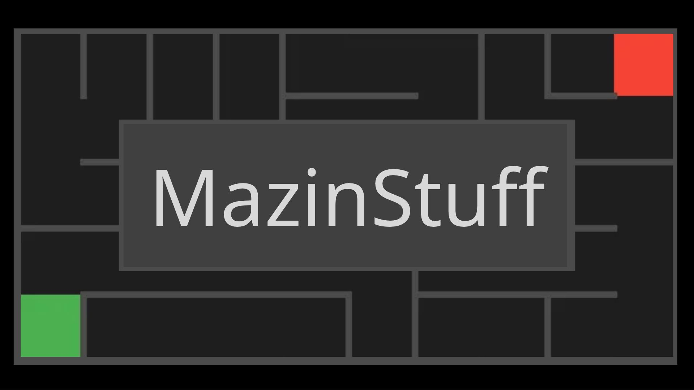

<p align="center">
  
</p>

<h3 align="center">A Customizable Maze Generator, Solver & Explorer</h3>

<p align="center">
  Generate, visualize, solve and explore mazes with different geometries, algorithms and visual styles.
</p>

<p align="center">
  <strong>Version 2.0.0</strong> · Java 21 · JavaFX 21
</p>

---

## Overview

**MazinStuff** is a desktop application built with Java and JavaFX that allows users to generate, solve and interact with procedurally generated mazes.

It combines multiple maze-generation algorithms, graph-based pathfinding, interactive gameplay and extensive visual customization in one application.

Whether you want to experiment with algorithms, create interesting labyrinths or challenge yourself by navigating through them, MazinStuff provides the tools to do so.

## Features

### 1. Multiple Maze Geometries

Generate mazes using four different topologies:

- **Rectangular** – Traditional grid-based mazes.
- **Circular / Polar** – Ring-based mazes arranged around a center.
- **Hexagonal** – Mazes made of six-sided cells.
- **Triangular** – Mazes made of triangular cells.

### 2. Maze Generation Algorithms

Choose between five generation algorithms:

| Algorithm | Description |
|---|---|
| Recursive Backtracker (DFS) | Creates long, winding corridors. |
| Randomized Prim's | Produces branched maze structures. |
| Randomized Kruskal's | Builds mazes using randomized edge selection. |
| Aldous-Broder | Uses random walks to generate uniform spanning trees. |
| Wilson's | Generates uniform spanning trees using loop-erased random walks. |

Generation speed and maze complexity can be customized.

### 3. Pathfinding & Solving

Explore different approaches to solving mazes:

- **Breadth-First Search (BFS)** – Finds a path with the fewest cell transitions in an unweighted maze.
- **Depth-First Search (DFS)** – Explores possible routes using depth-first traversal.
- **Dijkstra's Algorithm** – Finds a minimum-cost path using weighted distances.

View the generated solution directly on the maze canvas.

### 4. Interactive Gameplay & Fog of War

Turn generated mazes into playable puzzles.

- Navigate through mazes using keyboard controls or mouse interaction, depending on the topology.
- Discover passages and explore the maze yourself.
- Enable **Fog of War** to hide unexplored cells.
- Adjust the visibility radius.
- Track your progress as you approach the exit.

### 5. Advanced Theme & Appearance Customization

Make your mazes look the way you want.

Choose from predefined themes:

- Default Dark
- Cyberpunk
- Retro Arcade
- Classic Blueprint
- Forest Dungeon

Customize individual colors, including:

- Canvas background and floor.
- Wall color.
- Player tint.
- Solution highlight.
- Generation head.
- Entrance and exit colors.

Additional rendering options include:

- Adjustable wall thickness.
- Rounded or square wall corners.
- Solid, dashed and dotted wall styles.
- Dark and Light interface modes.

**Theme preferences are saved automatically**, so your chosen appearance is restored when you reopen the application.

### 6. Maze Management & Export

- Save generated mazes to `.maze` files.
- Load previously saved mazes.
- Export maze canvases as PNG images.
- Reproduce mazes using generation seeds.
- Share maze configurations through share codes.
- Access the Daily Maze Challenge.

### 7. Statistics & Performance Benchmarking

Explore maze-generation and solving performance through:

- Total cell count.
- Dead-end count.
- Solution path length.
- Algorithm performance comparisons.
- Generation and solving benchmarks.

---

## Getting Started

### For Users – Windows

The easiest way to use MazinStuff is through the standalone Windows installer.

1. Visit the [GitHub Releases](https://github.com/GreyTimes/MazinStuff/releases) page.
2. Download the latest `MazinStuff-2.0.0.exe` installer.
3. Run the installer and follow the installation instructions.
4. Launch MazinStuff from your Desktop or Start Menu.

**You do not need to install Java separately.** The Windows distribution includes its own Java runtime.

### Basic Usage

1. Select a maze topology.
2. Choose a generation algorithm.
3. Configure the maze dimensions and other generation settings.
4. Select an entrance and exit mode.
5. Click **Generate Labyrinth**.
6. Use **Show Solution** to visualize a route through the maze.
7. Enable **Playable Mode** to explore the maze yourself.
8. Customize its appearance through the theme customizer.
9. Save or export your generated maze.

Use the information icons (`ℹ`) throughout the interface for additional explanations of individual controls and algorithms.

---

## For Developers

### Requirements

- JDK 21.
- Gradle (included through the Gradle Wrapper).
- Internet connection for the initial dependency download.

The application uses JavaFX 21 and Gson.

### Clone the Repository

```bash
git clone https://github.com/GreyTimes/MazinStuff.git
cd MazinStuff
```

### Run the Application

**Windows:**

```powershell
.\gradlew.bat run
```

**Linux / macOS:**

```bash
./gradlew run
```

### Run Tests

**Windows:**

```powershell
.\gradlew.bat clean test
```

**Linux / macOS:**

```bash
./gradlew clean test
```

### Build the Windows Distribution

The project uses Gradle and the Badass Runtime plugin to generate a custom Java runtime and package the application.

To create the application image:

```powershell
.\gradlew.bat clean jpackageImage
```

To generate the Windows installer:

```powershell
.\gradlew.bat jpackage
```

Building Windows installers requires a Windows development environment, JDK 21 and WiX Toolset.

---

## Technology Stack

| Technology | Purpose |
|---|---|
| Java 21 | Core application and algorithms |
| JavaFX 21 | Desktop graphical interface |
| Gradle | Build automation and dependency management |
| Gson | JSON serialization support |
| Java Preferences API | Persistent appearance preferences |
| jpackage | Standalone application packaging |

---

## Project Structure

```text
MazinStuff/
├── src/
│   ├── main/
│   │   ├── java/
│   │   │   ├── app/
│   │   │   ├── model/
│   │   │   ├── generator/
│   │   │   ├── solver/
│   │   │   └── view/
│   │   └── resources/
│   └── test/
├── packaging/
├── gradle/
├── build.gradle
├── settings.gradle
├── gradlew
└── gradlew.bat
```

The project is organized into application, model, generation, solving and presentation components.

---

## Releases

Download the latest version from:

**[MazinStuff – GitHub Releases](https://github.com/GreyTimes/MazinStuff/releases)**

Current release: **v2.0.0**

The current standalone distribution targets Windows x64.

---

## Contributing

Contributions, bug reports and feature suggestions are welcome!

1. Check existing issues before opening a new one.
2. Create a feature branch for your changes.
3. Follow the existing project structure and coding conventions.
4. Test your changes before submitting a pull request.
5. Describe your changes clearly in the pull request.

Please use the repository's issue tracker to report bugs or suggest improvements.

---

## License

MazinStuff is distributed under the **MIT License**.

See the [LICENCE](LICENCE) file for the full license text.

---

<p align="center">
  Made with Java and JavaFX by <a href="https://github.com/GreyTimes">GreyTimes</a>.
</p>